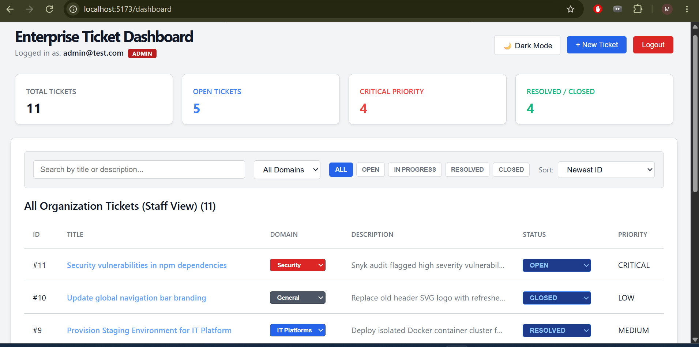
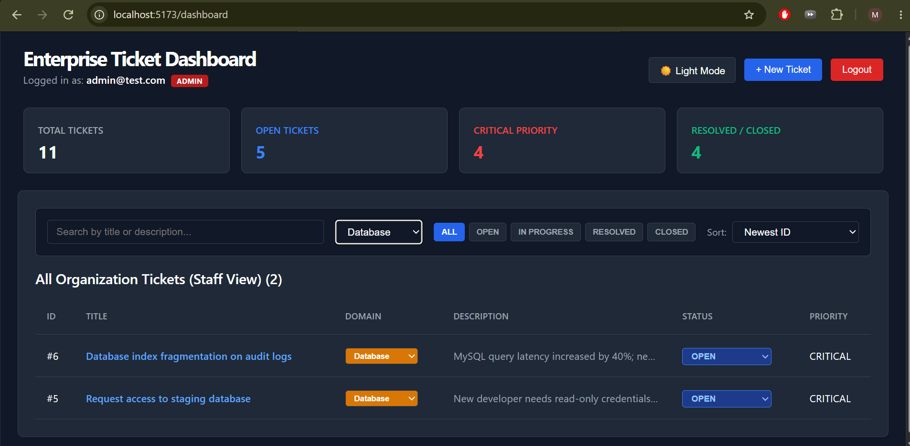
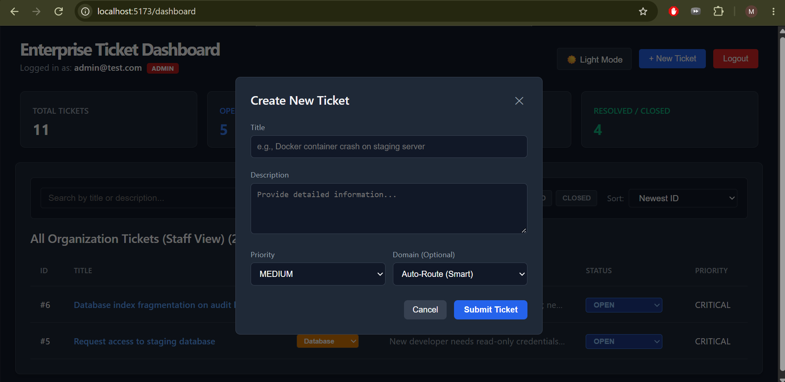
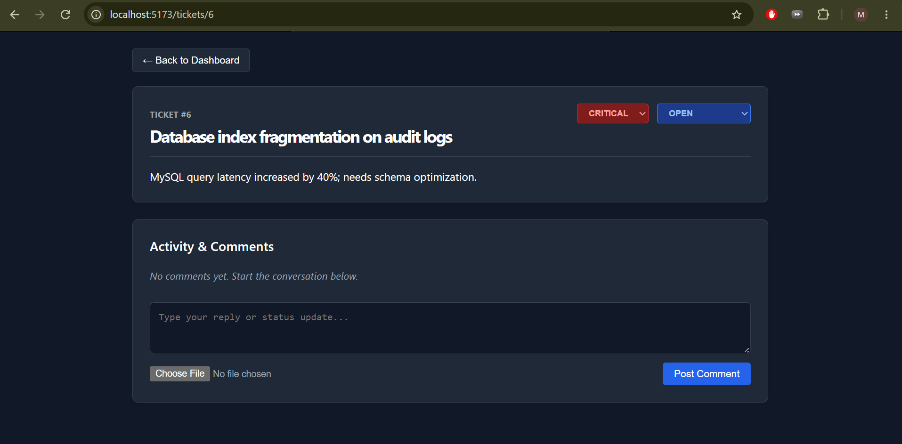

# Enterprise Service Desk & Ticket System 🚀

A full-stack, enterprise-grade Ticket Management & Operations Platform built with **Node.js, Express, React, and MySQL**. Designed to handle multi-domain categorical routing, role-based access control (RBAC), real-time ticket analytics, dynamic filtering, and interactive collaboration.

---

## 📸 Interface Overview

### 1. Main Dashboard (Staff & Admin View)


### 2. Multi-Domain Filtering & Dark Mode Toggle


### 3. Smart Ticket Creation Modal


### 4. Single Ticket Detail & Activity Collaboration View


---

## ✨ Key Features

* **Multi-Domain Routing:** Categorize and route tickets dynamically across 5 core domains: **Security**, **Database**, **R&D**, **IT Platforms**, and **General**.
* **Role-Based Access Control (RBAC):** 
  * **Standard Users:** Scope-restricted view to manage and submit their own issues.
  * **Agents & Admins:** Organization-wide view with permissions to update status, re-assign tickets, and adjust operational domains.
* **Real-Time Analytics Metrics:** Live KPI indicators for *Total Tickets*, *Open Tickets*, *Critical Priority*, and *Resolved/Closed* items.
* **Dynamic Sorting & Filtering:** Multi-variable client-side and server-side filtering by status, priority weight, domain category, and live search queries.
* **Fluid UI/UX Theme Engine:** Native dark and light mode toggle with state persistence.
* **Threaded Activity & Collaboration:** Detailed single-ticket view with activity timestamps, status transition management, and comment auditing.

---

## 🛠 Tech Stack & Architecture

### **Backend**
* **Runtime:** Node.js, Express.js (REST API)
* **Database:** MySQL 8.0 (Relational schema with foreign keys & indexed lookups)
* **Database Client:** `mysql2` (Connection pooling & async/await query execution)
* **Authentication:** JSON Web Tokens (JWT) & bcrypt password hashing

### **Frontend**
* **Framework:** React.js (Vite environment)
* **State Management & Routing:** React Hooks (`useState`, `useEffect`), React Router v6
* **HTTP Client:** Axios (Configured with API interceptors for auth header injection)
* **Styling:** Dynamic CSS inline theme mapping

---

## 🗄 Database Schema Design

```sql
CREATE TABLE users (
    id INT AUTO_INCREMENT PRIMARY KEY,
    name VARCHAR(255) NOT NULL,
    email VARCHAR(255) UNIQUE NOT NULL,
    password VARCHAR(255) NOT NULL,
    role ENUM('USER', 'AGENT', 'ADMIN') DEFAULT 'USER',
    created_at TIMESTAMP DEFAULT CURRENT_TIMESTAMP
);

CREATE TABLE tickets (
    id INT AUTO_INCREMENT PRIMARY KEY,
    title VARCHAR(255) NOT NULL,
    description TEXT NOT NULL,
    domain VARCHAR(50) DEFAULT 'General',
    status ENUM('OPEN', 'IN_PROGRESS', 'RESOLVED', 'CLOSED') DEFAULT 'OPEN',
    priority ENUM('LOW', 'MEDIUM', 'HIGH', 'CRITICAL') DEFAULT 'MEDIUM',
    created_by INT NOT NULL,
    assigned_to INT NULL,
    created_at TIMESTAMP DEFAULT CURRENT_TIMESTAMP,
    updated_at TIMESTAMP DEFAULT CURRENT_TIMESTAMP ON UPDATE CURRENT_TIMESTAMP,
    FOREIGN KEY (created_by) REFERENCES users(id) ON DELETE CASCADE,
    FOREIGN KEY (assigned_to) REFERENCES users(id) ON DELETE SET NULL
);

CREATE TABLE comments (
    id INT AUTO_INCREMENT PRIMARY KEY,
    ticket_id INT NOT NULL,
    user_id INT NOT NULL,
    message TEXT NOT NULL,
    created_at TIMESTAMP DEFAULT CURRENT_TIMESTAMP,
    FOREIGN KEY (ticket_id) REFERENCES tickets(id) ON DELETE CASCADE,
    FOREIGN KEY (user_id) REFERENCES users(id) ON DELETE CASCADE
);
